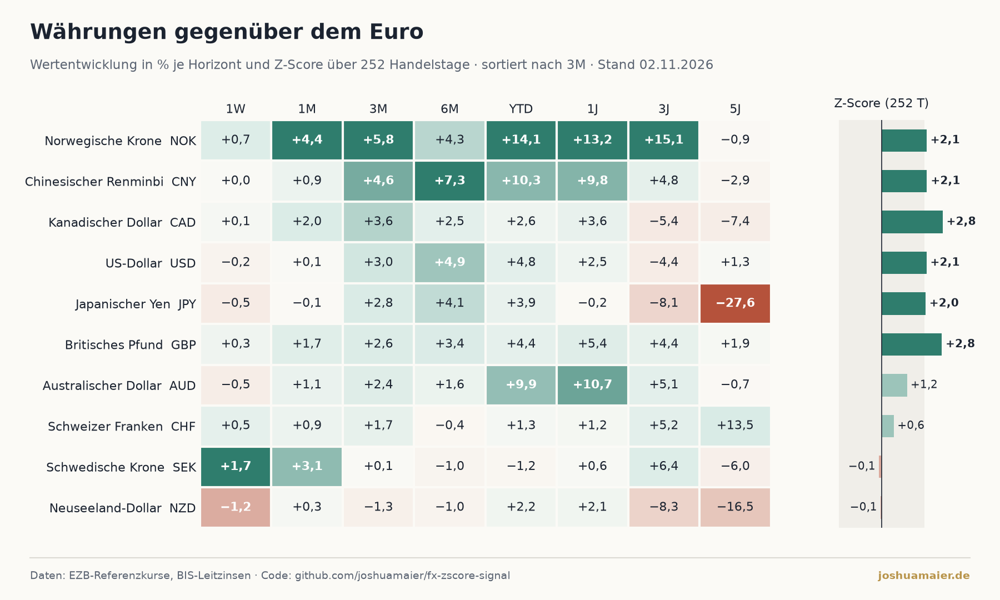
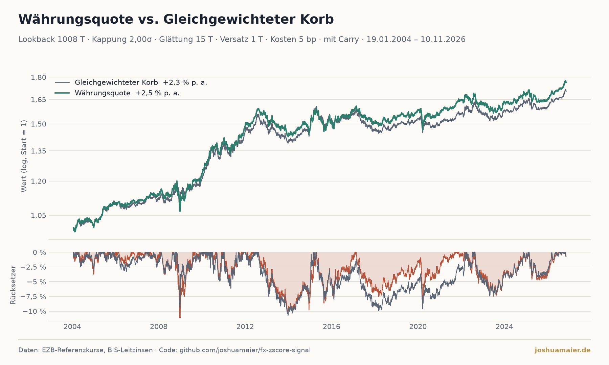

# FX Z-Score Signal

Automatisierte Währungsanalyse aus Sicht eines Euro-Anlegers: Wertentwicklung über acht
Horizonte plus Z-Score-Signal. Eine GitHub Action holt
jeden Morgen um **08:00 UTC** die aktuellen Referenzkurse der
[Europäischen Zentralbank](https://www.ecb.europa.eu/stats/policy_and_exchange_rates/euro_reference_exchange_rates/) (EZB), ergänzt die gespeicherte
Historie, rechnet die Analyse neu und aktualisiert die Grafik
[`charts/fx_analysis.png`](charts/fx_analysis.png).

Der Blogbeitrag auf [joshuamaier.de](https://joshuamaier.de) bindet genau diese Datei ein –
die Website selbst ruft keine Daten ab und rechnet nichts.

```text
EZB ──► GitHub Action (08:00 UTC) ──► data/fx_timeseries.csv ──► Analyse
                                                                   │
                        joshuamaier.de/blog ◄── charts/fx_analysis.png + fx_summary.json
```



## Methodik

- **Universum:** USD, JPY, GBP, CNY, CHF, CAD, AUD, NZD, SEK, NOK – jeweils gegenüber dem Euro.
  Die Rohdaten werden gegen USD gespeichert und in EUR-Kreuzkurse umgerechnet:
  Wert von 1 Einheit Fremdwährung in EUR = `USDEUR / USDXXX`.
- **Wertentwicklung** über 1W, 1M, 3M, 6M, YTD, 1J, 3J und 5J (Handelstage: 5/21/63/126/252/756/1260).
  Positiv = die Währung hat gegenüber dem Euro aufgewertet.
- **Z-Score-Signal:** `z = (Kurs heute − Ø der letzten 252 Handelstage) / Standardabweichung
  derselben 252 Tage`. `z ≥ +2` → Signal *stark* (Währung ungewöhnlich teuer gegenüber dem Euro),
  `z ≤ −2` → *schwach*, sonst *neutral*. Fenster und Schwelle: `ZSCORE_WINDOW`, `ZSCORE_THRESHOLD`.
- **Trend:** Abstand des aktuellen Kurses zum 200-Tage-Durchschnitt (in `fx_summary.json`).
- **Darstellung:** Heatmap, deren Farbskala je Horizont normiert ist (eine Wochenbewegung von 2 %
  ist bedeutsamer als dieselbe Bewegung über fünf Jahre); daneben der Z-Score als Balken, das
  neutrale Band ±2 grau hinterlegt.
- Zusätzlich entsteht `charts/fx_summary.json` mit allen Kennzahlen und einer kurzen,
  automatisch formulierten Einordnung, die der Blogbeitrag anzeigt.

Die Analyse-Basis (`ANALYSIS_BASE`), das Währungsuniversum und die Horizonte stehen in
[`src/fx_analysis/config.py`](src/fx_analysis/config.py).

## Währungsquote – Über-/Untergewichtung mit Backtest

Über-/Untergewichtung der Währungen eines Korbs nach ihrem z-Score, getestet gegen den Korb selbst
([`src/fx_analysis/quote.py`](src/fx_analysis/quote.py)), gerechnet auf den Kursen aus `data/fx_timeseries.csv`
und optional den Leitzinsen aus `data/policy_rates.csv`. Die Regeln:

```text
z        = (log(Kurs) − gleitendes Mittel) / gleitende Streuung (ddof=0)   je Währung
Faktor   = 1 − clip(z, −Kappung, +Kappung) / Kappung                          0 … 2
Gewicht  = SMA(Faktor, Glättung), um den Versatz verschoben, × Grundgewicht, täglich auf 100 % normiert
```

| Abweichung vom eigenen Mittel | Gewicht |
|---|---|
| +Kappung (Vorgabe +2σ) | 0 % – nicht investiert |
| 0 | genau das Grundgewicht |
| −Kappung | das Doppelte des Grundgewichts |

- **Korb:** der Euro als Numeraire (Kurs konstant 1, z-Score immer 0, bleibt beim Grundgewicht) plus die
  zehn Währungen oben – elf Währungen. Kurse = Wert einer Einheit in EUR, Renditen = Spotrendite aus Sicht
  eines Euro-Anlegers, plus Zins (Carry), sobald Leitzinsen vorliegen.
- **Immer voll investiert:** FX kennt keine Kasse, die Rohgewichte werden täglich auf Summe 1 renormiert.
- **Benchmark = Grundgewicht:** `equal` (1/N) oder `trade` (BIS-Handelsanteile April 2025,
  `TRADE_SHARES`, auf den Korb renormiert). NZD steht dort noch mit dem Wert von 2022. Vorgabe: `equal`.
- **Carry:** Jede Währung verdient zusätzlich ihren Notenbank-Leitzins (BIS, Datensatz `WS_CBPOL`, für alle elf
  Währungen, kostenlos, kein Key). Zinsen laufen an jedem Kalendertag (act/365): die Rendite am Montag enthält auch das Wochenende. Auch der Euro
  als Numeraire verdient seinen Zins. Fehlen die Zinsen, läuft die Währungsquote ohne Carry (`QUOTE_CARRY=0` schaltet ihn ab). Der Leitzins
  ist eine Näherung an Geldmarkt- bzw. Swapsätze; die Sharpe-Ratio ist brutto (kein risikoloser Zins abgezogen).
- **Kein Blick in die Zukunft:** Versatz ≥ 1 Tag – der Schluss des Vortages entscheidet.
- **Ausgaben:** `charts/fx_quote_backtest.png` (Wertentwicklung + Rücksetzer),
  `charts/fx_quote_weights.png` (Gewichte über die Zeit) und `charts/fx_quote.json` (Kennzahlen,
  aktuelle Gewichte je Währung). Die tägliche Action erzeugt sie mit; ist die Historie für den
  Vorlauf zu kurz, wird die Währungsquote übersprungen, die übrige Analyse läuft normal.

| Parameter | Konstante | Vorgabe |
|---|---|---|
| Lookback (Mittel + Streuung) | `QUOTE_LOOKBACK` | 1008 Tage (4 J.) |
| Kappung | `QUOTE_CAP` | 2,0σ |
| Glättung (SMA auf den Faktor) | `QUOTE_SMOOTHING` | 15 Tage |
| Versatz | `QUOTE_LAG` | 1 Tag |
| Kosten | `QUOTE_COST_BP` | 5 bp |
| Korb (Benchmark) | `benchmark` | `equal` |

**Vorlauf:** Der Backtest beginnt erst nach `lookback + smoothing + lag` Handelstagen. Deshalb lädt der
tägliche Lauf immer die **komplette EZB-Historie ab 1999** (CNY erst ab 2005; der Backtest startet dann mit dem
Vorlauf der kürzesten Reihe).

```python
from fx_analysis import quote, store

bt = quote.run(store.wide(store.load()), rates=store.load_rates(), benchmark="trade")
quote.comparison(bt)        # Rendite, Vola, Sharpe, Sortino, Max. Drawdown, Calmar … vs. Korb
quote.annual_returns(bt)    # Kalenderjahre
quote.signal_status(bt)     # z-Score, Faktor, Gewicht je Währung – von „teuer“ nach „billig“
```

## Datenbasis

| Quelle | Umfang | Aufrufe |
|---|---|---|
| EZB-Referenzkurse (ECB reference rates), abgerufen über [Frankfurter](https://www.frankfurter.app) | komplette Historie ab 1999, 10 Währungen gegen USD | ca. 28 Requests pro Tag (ein Jahr je Request) |
| BIS-Leitzinsen (`WS_CBPOL`) | Notenbank-Leitzins aller 11 Währungen, täglich | 1 Request pro Tag |

Beide kostenlos, ohne API-Key. Frankfurter ist ein freier Open-Source-Dienst, der die Referenzkurse der EZB
unverändert bereitstellt; die Daten selbst stammen von der EZB.

**Ein Job statt Backfill + Update:** Der tägliche Lauf lädt jedes Mal die gesamte Historie und überschreibt
die gespeicherten Kurse mit den frischen EZB-Werten. Das kostet nichts (kein Limit, kein Key), heilt verpasste
Läufe und nachträgliche Korrekturen von selbst, und unveränderte Kurse erzeugen keinen Git-Diff. Schlägt der
Abruf fehl, bleibt die gespeicherte Reihe unverändert.

Die Zeitreihe liegt als `data/fx_timeseries.csv` im Long-Format `date,pair,close` vor
(`pair = USDEUR` heißt: 1 USD = `close` EUR). Das entspricht der Tabelle

```sql
CREATE TABLE fx_timeseries (date DATE, pair VARCHAR(10), close FLOAT, PRIMARY KEY (date, pair));
```

CSV statt SQLite hält die täglichen Commits klein und nachvollziehbar;
`fx_analysis.store.to_sqlite()` erzeugt bei Bedarf die SQLite-Tabelle.

Hinweis: Die EZB veröffentlicht ihre Referenzkurse arbeitstäglich gegen 14:15 MEZ; der Lauf um
08:00 UTC übernimmt daher den Kurs des Vortags. Für die betrachteten Horizonte ist der Effekt
vernachlässigbar. Wochenenden werden nicht gespeichert.

## Struktur

```text
├── .github/workflows/
│   ├── daily_update.yml   # täglich 08:00 UTC: EZB-Daten laden, Analyse, Grafik, Commit
│   └── tests.yml
├── blog/                  # waehrungsquote.template.md (Vorlage) → waehrungsquote.md (täglich befüllt)
├── charts/                # fx_analysis.png, fx_summary.json, fx_quote_*.png, fx_quote.json (von der Action erzeugt)
├── docs/                  # fx_interactive.html – interaktives Chart (GitHub Pages)
├── data/                  # fx_timeseries.csv, policy_rates.csv (nur Änderungen)
├── notebooks/FX_Analysis.ipynb
├── src/fx_analysis/       # config, store, sources, analysis, quote, charts, interactive, pipeline
├── tasks/
│   └── update_fx.py       # der einzige Job: voller Abruf + alle Ausgaben
└── tests/
```

## Setup

1. **Keine Secrets nötig:** EZB-Kurse und BIS-Leitzinsen sind frei verfügbar, es werden keine API-Keys benötigt.
2. **Workflow-Rechte:** *Settings → Actions → General → Workflow permissions* auf
   „Read and write permissions“ stellen, damit die Action committen darf.
3. **GitHub Pages** einschalten (für das interaktive Chart): *Settings → Pages → Deploy from a branch →
   `main` / `/docs`*.
4. Den ersten Lauf manuell starten: *Actions → Daily FX update → Run workflow*. Danach läuft er täglich allein.

Lokal:

```bash
python -m venv .venv && source .venv/bin/activate
pip install -r requirements.txt pytest
python tasks/update_fx.py            # volle Historie; --years 5 für einen kurzen Testlauf
pytest -q
```

## Einbindung auf der Website

**Interaktives Chart** (Zoom, Hover, Zeitraum-Buttons, Kennzahlen, Gewichte; passt sich Hell/Dunkel an):

```html
<iframe id="fx" src="https://joshuamaier.github.io/fx-zscore-signal/fx_interactive.html"
        style="width:100%;height:2400px;border:0" loading="lazy" title="FX Z-Score Signal"></iframe>
<script>
  // Die Seite meldet ihre Höhe, damit kein Scrollbalken im iframe entsteht.
  addEventListener("message", e => { if (e.data && e.data.fxHeight) document.getElementById("fx").style.height = e.data.fxHeight + "px"; });
</script>
```

Alternativ die Datei `docs/fx_interactive.html` auf den eigenen Server kopieren – sie ist eigenständig
(Daten eingebettet, nur Plotly wird per CDN geladen).

**Statische Grafik:**

```html

```

**Kennzahlen als JSON:** `https://raw.githubusercontent.com/joshuamaier/fx-zscore-signal/main/charts/fx_quote.json`
und `…/charts/fx_summary.json`.

**Blogbeitrag:** [`blog/waehrungsquote.md`](blog/waehrungsquote.md) wird bei jedem Lauf aus der Vorlage
[`blog/waehrungsquote.template.md`](blog/waehrungsquote.template.md) neu erzeugt – die Zahlen im Text stimmen immer mit den Grafiken
überein. Text ändern: in der Vorlage (Platzhalter `{{…}}` stehen in `src/fx_analysis/blog.py`).

## Quellen

- **Wechselkurse:** Euro-Referenzkurse der [Europäischen Zentralbank](https://www.ecb.europa.eu/stats/policy_and_exchange_rates/euro_reference_exchange_rates/),
  abgerufen über [Frankfurter](https://www.frankfurter.app).
- **Leitzinsen:** Bank für Internationalen Zahlungsausgleich (BIS), Datensatz *Central bank policy rates* (`WS_CBPOL`).
- **Handelsanteile** für den handelsgewichteten Korb: BIS Triennial Central Bank Survey, April 2025
  (fest eingetragen in `config.py`).
- **Interaktives Chart:** [Plotly.js](https://plotly.com/javascript/) (MIT-Lizenz), geladen über jsDelivr.

Die Zeitreihen in `data/` und alle Grafiken erzeugt die tägliche Action aus diesen Quellen; nichts davon
wird von Hand gepflegt.

## Lizenz

MIT – siehe [LICENSE](LICENSE).
