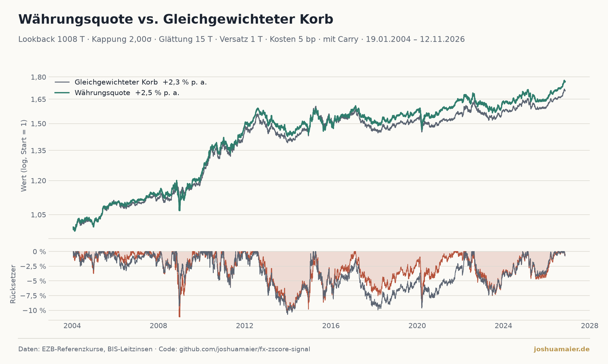

# Währungsquote: Was, wenn man teure Währungen untergewichtet?

*Stand 12.11.2026*

Wer als Euro-Anleger in Fremdwährungen investiert, hat meist ein festes Währungsgewicht im Kopf. Die Frage
dieses Beitrags: **Lohnt es sich, dieses Gewicht zu verschieben, sobald eine Währung im Vergleich zu ihrer eigenen
Geschichte ungewöhnlich teuer oder billig ist?**

Alle Zahlen und Grafiken stammen aus einem öffentlichen Repository
([fx-zscore-signal](https://github.com/joshuamaier/fx-zscore-signal)) und werden jeden Morgen automatisch neu
berechnet – auch die Zahlen in diesem Text. Datenquellen sind die **Europäische Zentralbank** (Referenzkurse,
Historie seit 1999) und die **BIS** (Notenbank-Leitzinsen für den Carry), beide kostenlos und ohne API-Schlüssel.

## Interaktive Grafik

<iframe id="fx" src="https://joshuamaier.github.io/fx-zscore-signal/fx_interactive.html"
        style="width:100%;height:2400px;border:0" loading="lazy" title="FX Z-Score Signal"></iframe>

*Statische Fassung:* 

## Die Idee in drei Sätzen

1. Für jede Währung wird der Kurs in Euro mit seinem eigenen Durchschnitt der letzten 4 Jahre
   verglichen: der **z-Score** sagt, um wie viele Standardabweichungen sie darüber (teuer) oder darunter (billig)
   liegt.
2. Daraus wird ein Gewichtsfaktor: bei z = 0 bleibt das Grundgewicht, bei der Kappungsschwelle sinkt es auf null,
   bei der negativen Schwelle verdoppelt es sich. Danach wird der Korb wieder auf 100 % normiert – es wird also nur
   umgeschichtet, nie zusätzlich investiert.
3. Der Backtest vergleicht diesen angepassten Korb mit demselben Korb bei festen Grundgewichten („Buy and Hold“).

Der Korb besteht aus Euro (als Bezugswährung), US-Dollar, Yen, Pfund, Renminbi, Franken, Kanadischem, Australischem
und Neuseeland-Dollar sowie Schwedischer und Norwegischer Krone. Vergleichsmaßstab: **Gleichgewichteter Korb**.

## Ergebnis: Kennzahlen im Überblick

19.01.2004 bis 12.11.2026 (23,2 Jahre). Einstellungen: Lookback 4 Jahre, Kappung 2,00σ, Glättung 15 Tage, Versatz 1 Tag(e), Kosten 5 bp, mit Carry.

| Kennzahl | Währungsquote | Gleichgewichteter Korb |
|---|---:|---:|
| Gesamtrendite | +76,8 % | +70,7 % |
| Rendite p. a. | +2,49 % | +2,33 % |
| Volatilität p. a. | 4,6 % | 4,4 % |
| Sharpe-Ratio | 0,55 | 0,55 |
| Sortino-Ratio | 0,81 | 0,80 |
| Max. Drawdown | −11,1 % | −10,7 % |
| Calmar-Ratio | 0,22 | 0,22 |
| Schlechtester Tag | −1,74 % | −1,91 % |

Die Währungsquote erzielt 2,49 % pro Jahr, der Korb 2,33 % – ein Vorsprung von 0,16 Prozentpunkten. Die Sharpe-Ratio liegt bei 0,55 gegenüber 0,55, der maximale Drawdown bei −11,1 % gegenüber −10,7 % (die Strategie fällt tiefer).

**Wie man die Kennzahlen liest:**

- **Rendite p. a.:** Bei Währungen ohne Zinsertrag erwartet man wenig. Wichtig ist der *Abstand* zum Korb.
- **Sharpe-Ratio:** Rendite im Verhältnis zum Schwankungsrisiko (ohne Abzug eines risikolosen Zinses).
- **Sortino-Ratio:** wie Sharpe, aber nur die Verlust-Schwankung zählt als Risiko.
- **Max. Drawdown:** der größte Rückgang vom Höchststand – die härteste Phase, die man hätte aushalten müssen.
- **Calmar-Ratio:** Rendite p. a. geteilt durch den maximalen Drawdown.

## Was der Test einrechnet – und was nicht

**Zinsen (Carry):** Jede Währung verdient zusätzlich ihren Leitzins (Notenbank-Leitzinsen der BIS, täglich abgerufen). Ohne Zinsen lägen Währungsquote und Korb bei 0,59 % bzw. 0,27 % pro Jahr, mit Zinsen bei 2,49 % bzw. 2,33 %. Die Sharpe-Ratio ist eine Bruttogröße ohne Abzug eines risikolosen Zinses.

**Kosten:** Die Strategie schichtet um – pro Jahr wird das 2,0-Fache des Korbwerts bewegt. Gerechnet ist mit 5 Basispunkten je Umschichtung: Ohne Kosten läge die Rendite p. a. bei 2,59 % und die Sharpe-Ratio bei 0,57, mit Kosten bei 2,49 % bzw. 0,55. Der Korb selbst wird nicht umgeschichtet und trägt keine Kosten.

- **Parameter:** Die Einstellungen wurden nicht auf die Vergangenheit optimiert. Wer Lookback, Kappung und
  Glättung im Nachhinein so wählt, dass der Backtest gut aussieht, begeht genau den Fehler, den man vermeiden will.
- **Zufall:** Gut zwei Jahrzehnte sind für Währungen nicht lang. Ein Vorsprung von wenigen Zehntelprozent ist
  statistisch kaum von Glück zu unterscheiden.
- **Leitzins als Näherung:** Der Carry wird mit dem Notenbank-Leitzins gerechnet, nicht mit dem, was ein Anleger
  tatsächlich am Geldmarkt oder über Swaps verdient.

## Und heute?

Am 12.11.2026 ist der Korb am stärksten in Neuseeland-Dollar (+9,5 pp), Japanischer Yen (+7,6 pp), Kanadischer Dollar (+6,5 pp) **übergewichtet** und in Norwegische Krone (−9,1 pp), Britisches Pfund (−6,6 pp), Chinesischer Renminbi (−5,6 pp) **untergewichtet**. Am „teuersten“ gegenüber dem eigenen Vierjahres-Verlauf ist Norwegische Krone (z = 2,28), am „billigsten“ Neuseeland-Dollar (z = −1,23).

In den letzten vier Wochen gegenüber dem Euro am stärksten: Chinesischer Renminbi (+1,4 %), am schwächsten: Australischer Dollar (−1,7 %).

## Nachbauen

Der gesamte Code ist offen: Ein einziger täglicher Job lädt die Kurse und Leitzinsen, rechnet alles neu und
veröffentlicht Grafiken, JSON, die interaktive Seite und diesen Text. Das Notebook `notebooks/FX_Analysis.ipynb`
erlaubt, Lookback, Kappung, Glättung, Kosten und Carry selbst zu ändern.

*Keine Anlageberatung. Vergangene Wertentwicklung ist kein verlässlicher Indikator für zukünftige Ergebnisse.*

*Daten: EZB-Referenzkurse, BIS-Leitzinsen · Code: [github.com/joshuamaier/fx-zscore-signal](https://github.com/joshuamaier/fx-zscore-signal)*
