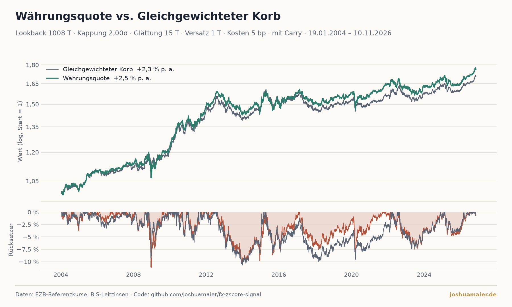

<!--
VORLAGE. Aus dieser Datei erzeugt der tägliche Job (tasks/update_fx.py) blog/waehrungsquote.md.
Alles in doppelten geschweiften Klammern wird bei jedem Lauf mit den aktuellen Zahlen gefüllt.
Text ändern: hier; blog/waehrungsquote.md nicht von Hand bearbeiten (wird überschrieben).
-->

# Währungsquote: Was, wenn man teure Währungen untergewichtet?

*Stand {{stand}}*

Wer als Euro-Anleger in Fremdwährungen investiert, hat meist ein festes Währungsgewicht im Kopf. Die Frage
dieses Beitrags: **Lohnt es sich, dieses Gewicht zu verschieben, sobald eine Währung im Vergleich zu ihrer eigenen
Geschichte ungewöhnlich teuer oder billig ist?**

Alle Zahlen und Grafiken stammen aus einem öffentlichen Repository
([fx-zscore-signal](https://github.com/joshuamaier/fx-zscore-signal)) und werden jeden Morgen automatisch neu
berechnet – auch die Zahlen in diesem Text. Datenquellen sind die **Europäische Zentralbank** (Referenzkurse,
Historie seit 1999) und die **BIS** (Notenbank-Leitzinsen für den Carry), beide kostenlos und ohne API-Schlüssel.

## Interaktive Grafik

<iframe id="fx" src="https://joshuamaier.github.io/fx-zscore-signal/fx_interactive.html"
        style="width:100%;height:2400px;border:0" loading="lazy" title="FX Z-Score Signal"></iframe>

*Statische Fassung:* 

## Die Idee in drei Sätzen

1. Für jede Währung wird der Kurs in Euro mit seinem eigenen Durchschnitt der letzten {{lookback_jahre}} Jahre
   verglichen: der **z-Score** sagt, um wie viele Standardabweichungen sie darüber (teuer) oder darunter (billig)
   liegt.
2. Daraus wird ein Gewichtsfaktor: bei z = 0 bleibt das Grundgewicht, bei der Kappungsschwelle sinkt es auf null,
   bei der negativen Schwelle verdoppelt es sich. Danach wird der Korb wieder auf 100 % normiert – es wird also nur
   umgeschichtet, nie zusätzlich investiert.
3. Der Backtest vergleicht diesen angepassten Korb mit demselben Korb bei festen Grundgewichten („Buy and Hold“).

Der Korb besteht aus Euro (als Bezugswährung), US-Dollar, Yen, Pfund, Renminbi, Franken, Kanadischem, Australischem
und Neuseeland-Dollar sowie Schwedischer und Norwegischer Krone. Vergleichsmaßstab: **{{korb}}**.

## Ergebnis: Kennzahlen im Überblick

{{start}} bis {{stand}} ({{jahre}} Jahre). Einstellungen: {{einstellungen}}.

{{kennzahlen_tabelle}}

{{ergebnis_satz}}

**Wie man die Kennzahlen liest:**

- **Rendite p. a.:** Bei Währungen ohne Zinsertrag erwartet man wenig. Wichtig ist der *Abstand* zum Korb.
- **Sharpe-Ratio:** Rendite im Verhältnis zum Schwankungsrisiko (ohne Abzug eines risikolosen Zinses).
- **Sortino-Ratio:** wie Sharpe, aber nur die Verlust-Schwankung zählt als Risiko.
- **Max. Drawdown:** der größte Rückgang vom Höchststand – die härteste Phase, die man hätte aushalten müssen.
- **Calmar-Ratio:** Rendite p. a. geteilt durch den maximalen Drawdown.

## Was der Test einrechnet – und was nicht

{{carry_absatz}}

{{kosten_absatz}}

- **Parameter:** Die Einstellungen wurden nicht auf die Vergangenheit optimiert. Wer Lookback, Kappung und
  Glättung im Nachhinein so wählt, dass der Backtest gut aussieht, begeht genau den Fehler, den man vermeiden will.
- **Zufall:** Gut zwei Jahrzehnte sind für Währungen nicht lang. Ein Vorsprung von wenigen Zehntelprozent ist
  statistisch kaum von Glück zu unterscheiden.
- **Leitzins als Näherung:** Der Carry wird mit dem Notenbank-Leitzins gerechnet, nicht mit dem, was ein Anleger
  tatsächlich am Geldmarkt oder über Swaps verdient.

## Und heute?

{{heute_absatz}}

{{monat_absatz}}

## Nachbauen

Der gesamte Code ist offen: Ein einziger täglicher Job lädt die Kurse und Leitzinsen, rechnet alles neu und
veröffentlicht Grafiken, JSON, die interaktive Seite und diesen Text. Das Notebook `notebooks/FX_Analysis.ipynb`
erlaubt, Lookback, Kappung, Glättung, Kosten und Carry selbst zu ändern.

*Keine Anlageberatung. Vergangene Wertentwicklung ist kein verlässlicher Indikator für zukünftige Ergebnisse.*

*Daten: EZB-Referenzkurse, BIS-Leitzinsen · Code: [github.com/joshuamaier/fx-zscore-signal](https://github.com/joshuamaier/fx-zscore-signal)*
